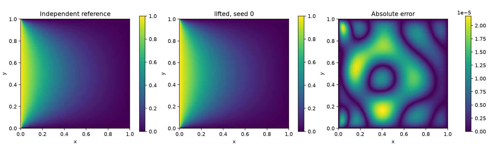

# 2D diffusion-reaction PINN: correction, boundary lifting and numerical checks

A compact scientific-machine-learning exercise for

\[
\Delta c-0.1c=0,\qquad (x,y)\in(0,1)^2.
\]

The open left edge has concentration 1; the other three open edges have
concentration 0. These data are discontinuous at the left corners. This is an
idealised, stationary concentration model, **not a fit to experimental data**.

The original notebook by John Meyor Medina Diaz is preserved as a read-only audit
fixture. This repository is a corrected and extended September 2026 revision.
It is not presented as a new PINN method or as validation of a biological
hypothesis. See [credits](CREDITS.md).

## What changed

1. The intended second derivative in y now explicitly uses Hessian indices
   `(i=1, j=1)`. The original call omitted `j`, selecting the mixed derivative.
2. A conventional PINN with boundary penalties (`soft`) is compared with
   `c_theta = A + x(1-x)y(1-y) N_theta` (`lifted`). Here A encodes the open-edge
   values and corner limits; the neural term cannot change those edge values.
3. Both models are checked against an independent sine-series solution,
   cross-checked using finite differences. The series is **not training data**.
4. The analytical lifting alone is measured separately: its benefit must not be
   credited entirely to the neural network.

The formulation, evaluation grids and pre-training thresholds are preserved in
[PROTOCOL.md](PROTOCOL.md). A is not the exact solution; its PDE residual is
nonzero. No neural-network error theorem is asserted.

## Recorded results

All three seeds for each model are included, with no failed runs omitted.
The two newly trained models use three hidden layers of width 32, float64,
1,024 interior points per seed, 1,200 Adam and 300 L-BFGS iterations.
The table reports errors on the 127 x 127 interior evaluation nodes.

| Method | Seeds | Relative L2 error (%) | PDE residual RMSE | All sampled criteria |
|---|---|---:|---:|---|
| Analytical lifting only | no training | 0.723538 | 0.166565 | No |
| Corrected soft-boundary PINN | 0, 1, 2 | 5.146263-7.016703 | 0.083767-0.152444 | No, all three |
| Analytical lifting + PINN | 0, 1, 2 | 0.001801-0.002481 | 0.002608-0.003162 | Yes, all three |

The PDE residual is evaluated on a separate 25 x 25 grid. Its **maximum**, not
shown as RMSE above, is 0.021119-0.028840 for the lifted runs; the threshold
0.02 applies to RMSE. These finite-grid checks do not certify continuous-domain
error, exact positivity everywhere, or general performance on other equations.



The original TensorFlow notebook used a different architecture/training budget.
These results are **not measurements of that historical trained network**.
Wall times are stored, but were not collected as a controlled speed benchmark.

## Run locally

Tested numerical environment: Python 3.12, Windows CPU, DeepXDE 1.15.0,
PyTorch 2.8.0+cpu, NumPy 2.3.5. Other platforms and bitwise reproducibility there
have not been verified. Start in this directory after downloading the package.
An isolated environment is recommended; do not install into an unrelated project.

```powershell
python -m venv .venv
.\.venv\Scripts\python.exe -m pip install -r requirements_cpu.txt
.\.venv\Scripts\python.exe -m unittest discover -s . -p "test_*.py" -v
```

Train all six runs plus the no-network control in a **new** output directory:

```powershell
.\.venv\Scripts\python.exe run_experiment.py --output results_new
.\.venv\Scripts\python.exe run_experiment.py --output results_new --audit-only
```

To check the included weights without retraining:

```powershell
.\.venv\Scripts\python.exe run_experiment.py --output results_neural_v1 --audit-only
```

The last command rewrites only the reload audit reports, not saved weights or
training metrics. Back up reports if you need their original bytes. Weight
loading uses `weights_only=True`; only load checkpoints you trust.

### Notebook

The notebook does not download packages or train automatically. Install its
optional execution dependencies in the same environment:

```powershell
.\.venv\Scripts\python.exe -m pip install -r requirements_notebook.txt
.\.venv\Scripts\python.exe execute_notebook.py --output walkthrough_executed.ipynb
```

This executes every cell, shows the recorded metrics, and reloads all six saved
models for verification. For an additional full seed-0 lifted training run:

```powershell
.\.venv\Scripts\python.exe execute_notebook.py --train --output training_executed.ipynb
```

The training variant requires `results_notebook_run` not to contain a previous
experiment. It does not overwrite existing results. JupyterLab/Notebook is not
bundled; an editor with notebook support may select this Python environment.

## Files and provenance

- `pinn2d.py`: PDE, two models, independent evaluation and diagnostic thresholds.
- `reference.py`: sine series, finite differences and static original audit.
- `test_*.py`: mathematical/implementation tests, including detection of the old bug.
- `fixtures/original_PINN_2D_Biology.ipynb`: pinned original, **never executed** by tests.
- `PINN_2D_Biology_improved.ipynb`: executable walkthrough; no copied historical outputs.
- `results_neural_v1`: six runs, control, weights, arrays, logs, metrics and figures.
- `results_neural_v1/executed_sources`: exact code/protocol used for those runs;
  hashes are recorded in `provenance.json`.

This portable package changes the original audit fixture's location and the
walkthrough/documentation, not the trained numerical model or recorded results.
The top-level runner includes an output-overwrite guard added after the six
recorded runs; its archived version is kept for provenance. The source hashes
should therefore be checked against `executed_sources`, not assumed to match
every later packaging change.

Repository source and documentation are released under the [MIT License](LICENSE).
Third-party dependencies retain their own licences.
